# Microsoft Entra-ID-Labs
**Entra ID Practical Labs - Users, Groups, Roles & External Collaboration Management**

# **Managing User Roles**

**Add New User**
1. Sign in to the Microsoft Entra admin center as a **Global Administrator**.

2. In the left menu, expand **Identity**.

3. Under **Users**, select **All Users**, then choose **+ New User**.

4. Create a user using the following settings:

| Setting | Value |
| --- | --- |
| **User principal name**: | CKBam |
| **Mail nickname**: | CKBam |
| **Display name**: | Bam Alexander |
| **Password**: | (Assigned password) |

5. Select **Create** to register the user in your organization.

.png?raw=true)

**Removing Users From Microsoft Entra ID**

1.	Navigate to the Microsoft Entra admin center. In the left navigation, under Identity, select **Users**

2.	In the **Users** list, select the check box for a user to delete. For example (**Tre Steward**.)

3.	With the user account selected, on the menu, select **Delete user**.

4.	Review the dialog box and then select **OK**.

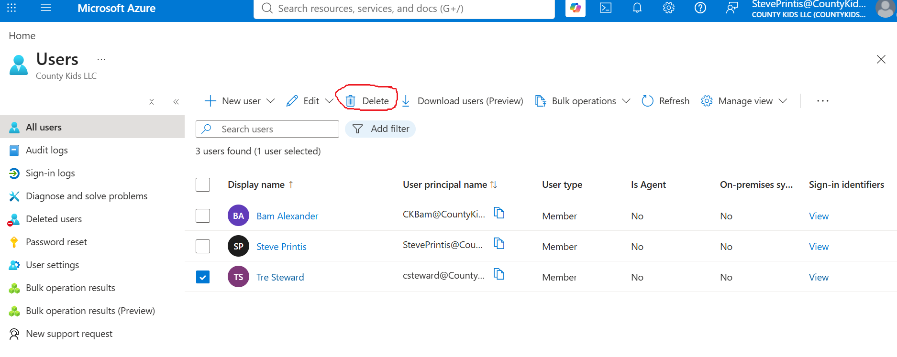

**Restoring Deleted User**

1.	In the Users page, in the left navigation, select **Deleted users**.

2.	Review the list of deleted users and select the user you deleted.

3.	On the menu, select **Restore user**. 

4.	Review the dialog box and then select **OK**.

5.	In the left navigation, select **All users**. Verify User was restored

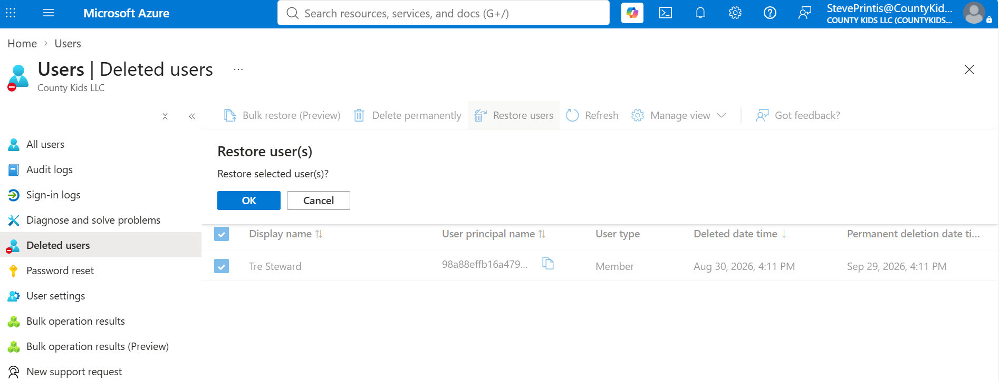

# **Assigning Roles To Users**

1.	In Microsoft Entra ID, on the **“All users screen”**, select **Bam Alexander**.

2.	On the user’s profile page, select **Assigned roles**. The Assigned roles page appears.

3.	Select **Add assignment**s, select the role to assign to the user (for example, **Application administrator**), and then select **Add**.

4.	Select **+ Add Assignment**. The newly assigned Application administrator role appears on the user’s Assigned roles page.

 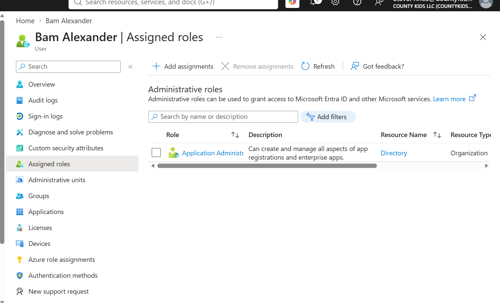

# **Removing Role Assignments**

1.	In Microsoft Entra ID, select **Users** - **All User**, and then select the user getting the role assignment removed. For example, **Bam Alexander**.

2.	Select **Assigned roles**, then select the name of the role your wish to remove - **Application Administrato**r.

3.	On the far-right side of the screen, select **Remove**. Then select **Yes** option when prompted for confirmation.

# **Controlling Permissions - Add and Restrict** 

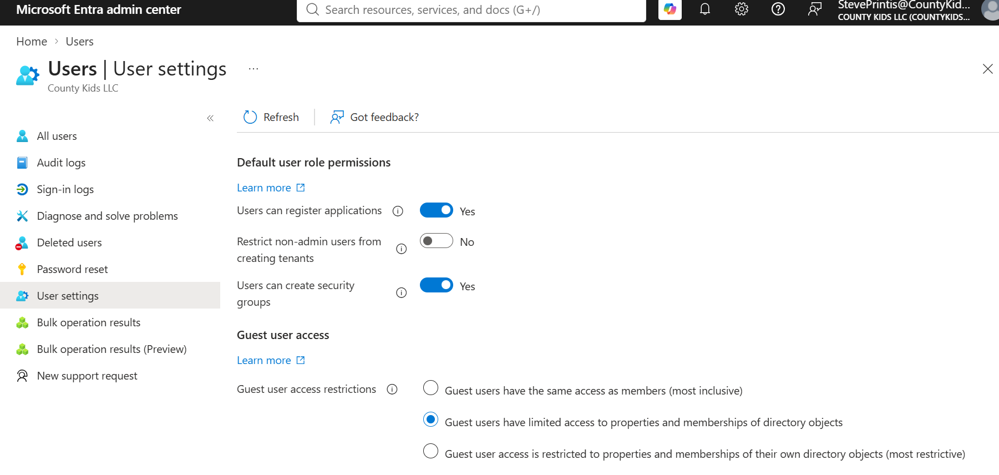

# **Exploring Available Permissions**

You can see the list of permissions in the description of each role. To open, launch Microsoft Entra ID, then open the Roles and administrators screen. Next select a role and open its description page from the ellipsis (...) menu. Depending on the role you chose, you'll see a large or small number of permissions. Two sets of permissions:

•	Role permissions

•	Guest and service principal basic read permissions

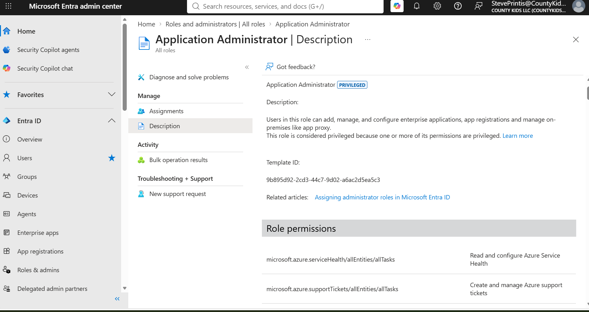

# **Configuring The External User Options**

 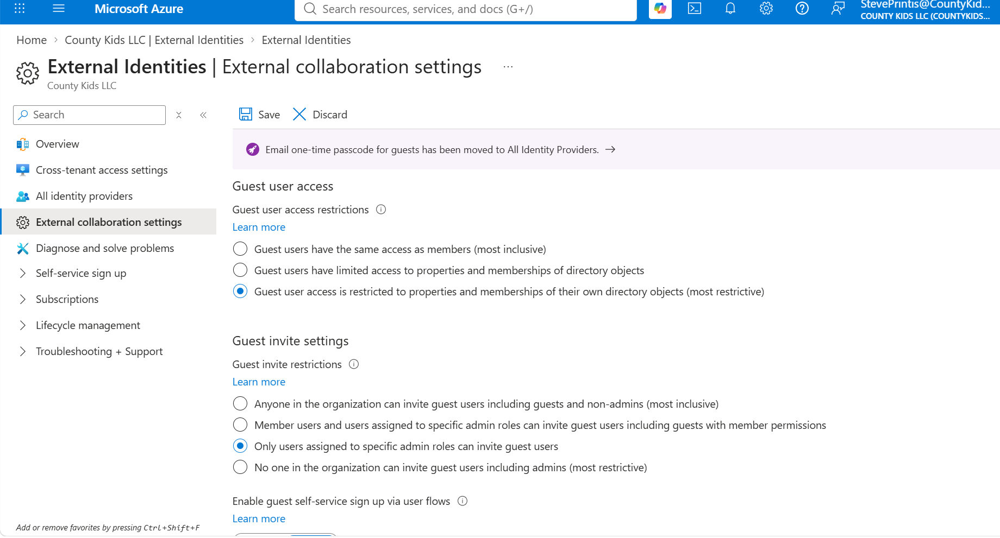

•	**Guest user access** – Configured Guest User access to the most restrictive setting, “restricted to properties and memberships of their own directory objects.”

•	**Guest invite settings** – Configured Guest invite settings to “Member users and users assigned to specific admin roles can invite guest users including guests with member permissions.”

•	**Guest self-service up**– Disabled guest self-service sign up via user flows.

# **Setting Tenant Wide Properties**

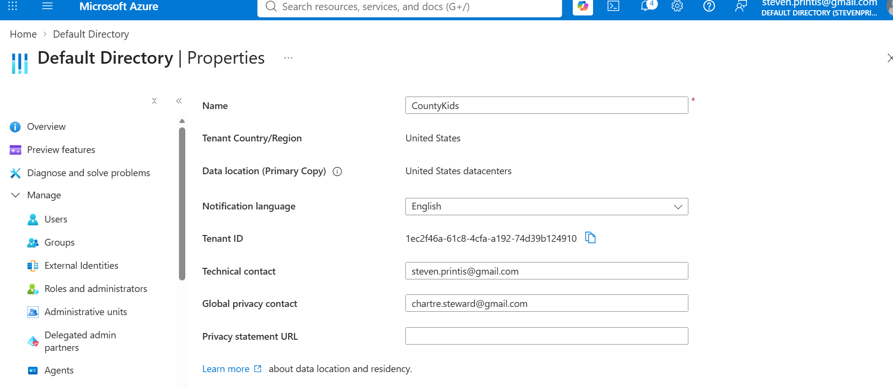

1.	Select the **Show portal menu** hamburger icon and then select **Microsoft Entra ID**

2.	In the left navigation, in the Manage section, select **Properties**.

3.	In the **Name** box, the tenant name was changed from Default Directory to “CountyKids”.

4.	Select **Save** to update the tenant properties.

 # **Creating Security Group**

1.	Browse the Microsoft Entra admin center screen.

2.	In the left navigation, under **Identity**, select **Groups** and then **All groups**.

3.	In the Groups screen, on the menu, select **New group**.

4.	Create a group using the following information:

| Setting | Value |
| --- | --- |
| **Group type:** | Security |
| **Group name:** | Marketing |
| **Membership type:** | Assigned |
| **Owners:** | Admin account |
| **Members:** | Bam Alexander |

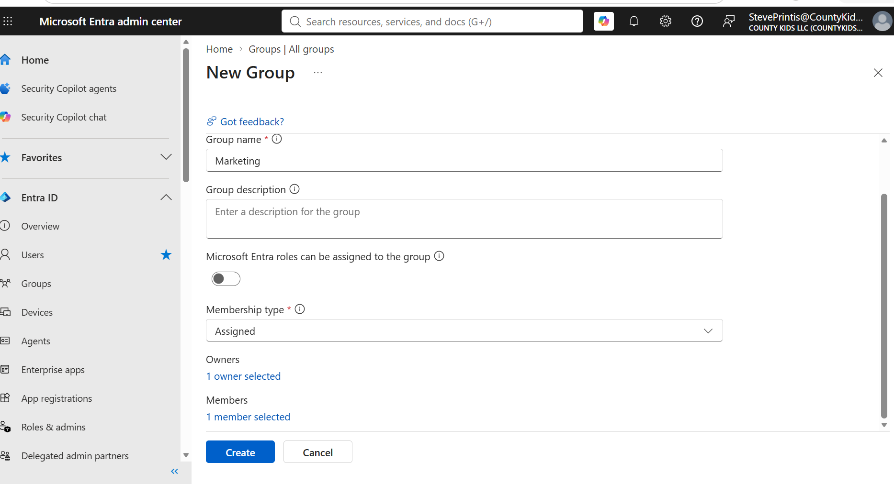

# **Creating Microsoft 365 Group**

1.	In the left navigation, under **Identity**, select **Groups**.

2.	In the Groups page, on the menu, select **New group**.

3.	Create a group using the following information:

| Setting | Value |
| --- | --- |
| Group type | Microsoft 365 |
| Group name | CountyKid Sales |
| Membership type | Assigned |
| Owners | Your admin account |
| Members | Assigned member |

4.	When complete, verify the group named CountyKid Sales is shown in the All groups list. 

 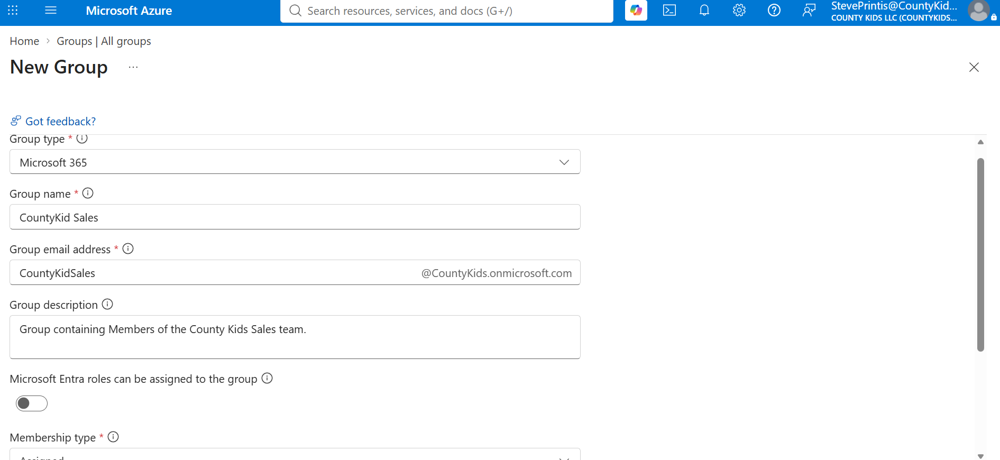

# **Assigning Group Licenses** 

1.	Go to the Microsoft 365 admin center at https://admin.microsoft.com.

2.	Select **Billing** from the menu on the left.

3.	Select **Licenses**.

4.	From the list of licenses you have available, select one.

5.	Select **Groups** from the list near the top of the screen.

6.	On the Groups page, select **+ Assign license**.

7.	Search for and select the **Marketing** group you created earlier.

8.	Select the **Assign** button at the bottom of the dialog.

9.	You should get a message that licenses were successfully assigned.

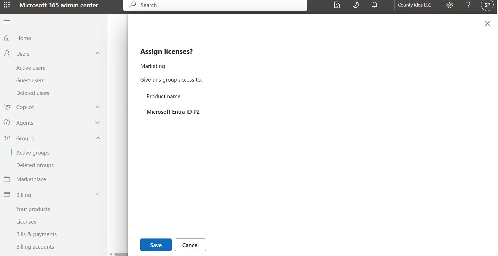

# **Changing Group License Assignment**

1.	In the left navigation, open **Groups**.

2.	Select **All groups**, then select one of the available groups.

3.	In the left navigation, under **Manage**, select **Licenses**.

4.	Review the current assignments and then, on the menu, select **+ Assignments**.

5.	Open https://admin.microsoft.com to open the Microsoft 365 admin center.

6.	Select **Billing**. Then select **Licenses**.

7.	Select an available license from the list.

8.	Select **Groups** from the menu near the top of the page.

9.	Select the **+ Assign licenses** option.

10.	Pick the group you were looking at earlier in Microsoft Entra. Then select the **Assign** button at the bottom of the page.

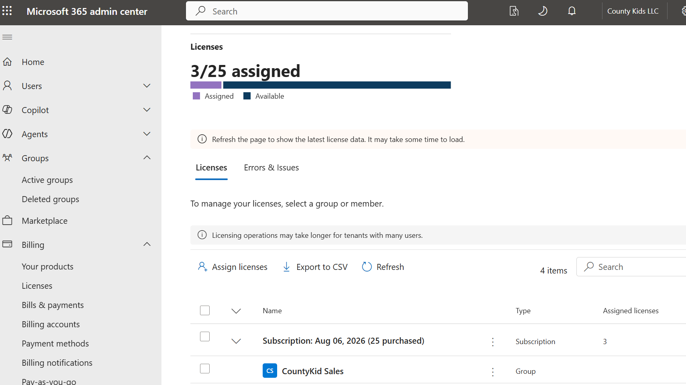

# **Configuring External Collaboration Settings**

1.	Select **Identity**.

2.	Select **External Identities** - **External collaboration settings**.

3.	Under **Guest user access**, review access levels that are available and then select Guest **user access is restricted to properties and memberships of their own directory objects (most restrictive)**.

4.	Under **Guest invite settings**, mark **Only user assigned to specific admin roles can invite guest users**.

# **Configuring An Identity Provider (Google)**

**Step 1: Configure a Google developer project**

First, create a new project in the Google Developers Console to obtain a client ID and a client secret that you can later add to Microsoft Entra ID.

1.	Go to the Google APIs at https://console.developers.google.com, and sign in with Google account.

2.	Accept the terms of service if prompted.

3.	Create a new project: On the dashboard, select **Create Project**, give the project a name (for example, **Microsoft Entra B2B**), and then select **Create**:

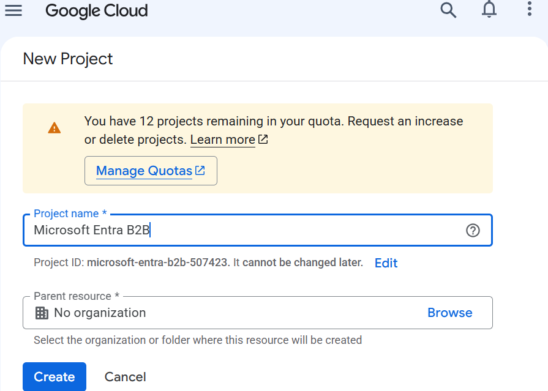

4.	On the **APIs and Services** page, select **View** under your new project. Select **Go to APIs overview** on the APIs card. Select **OAuth consent screen**. Select **External**, and then select **Create**. On the **OAuth consent screen**, enter an **Application name**

5.	 Select **Credentials**. On the **Create credentials** menu, select **OAuth client ID**

6.	Under **Application type**, select **Web application**. Give the application a suitable name, like **Microsoft Entra B2B**. Under **Authorized redirect URIs**, enter the following URIs:

•	**https://login.microsoftonline.com**

•	**https://login.microsoftonline.com/te/ tenant ID /oauth2/authresp (where tenant ID is the tenant ID in Azure)**

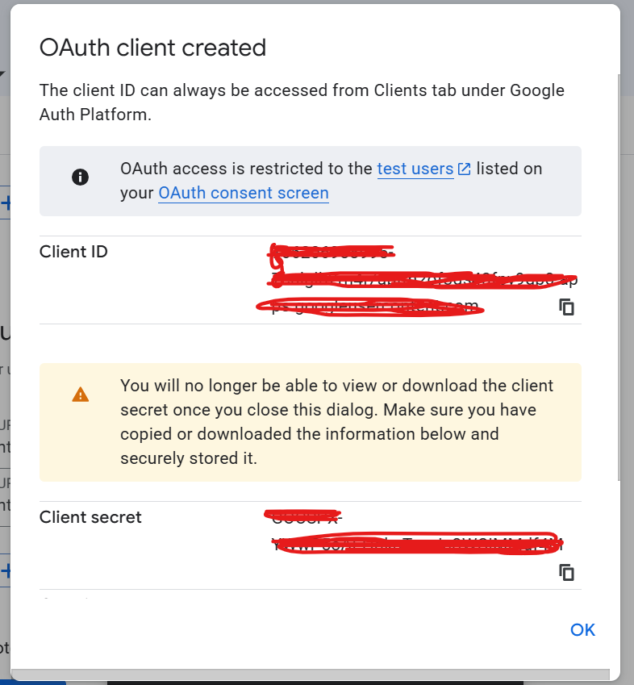

**Step 2: Configuring Google Federation In Microsoft Entra ID**

1.	Select **External Identities**.

2.	Select **All identity providers**, and then select the **Google** button.

3.	Enter the client ID and client secret you obtained earlier. Select **Save**:

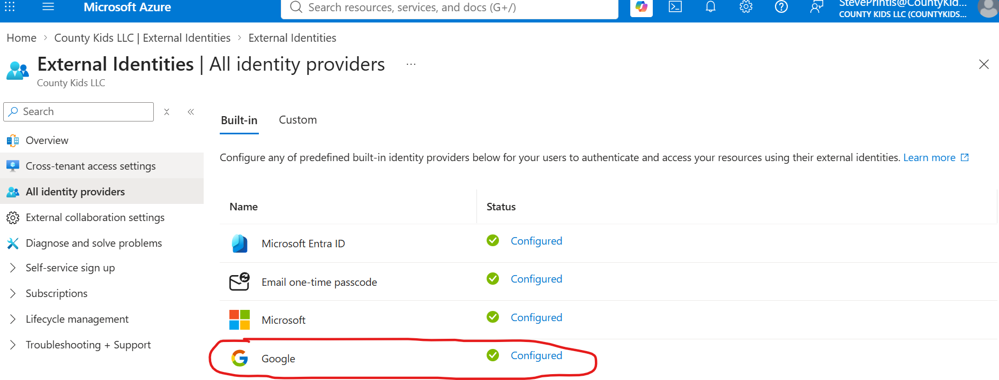

# **Adding Guest Users To Directory**

1.	Select **Identity**.

2.	Under **Users**, select **All Users**.

3.	Select **New user** - **Invite external user**.

4.	On the New user page, select **Invite user** and then add your information as the guest user. When complete, select **Invite**.

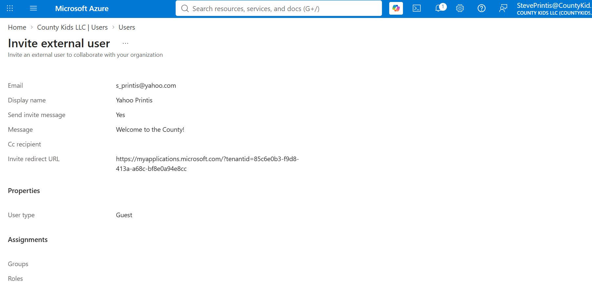

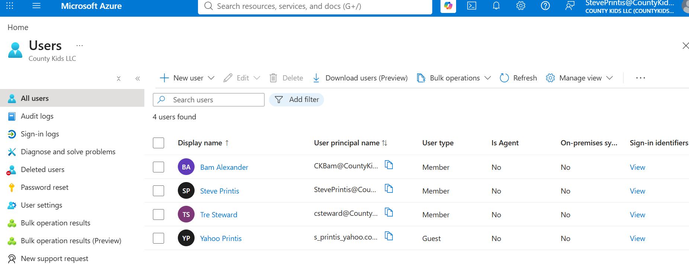

# **Inviting Guest Users (Bulk)**

1.	In the navigation pane, select **Identity**.

2.	Under **Users**, select **All Users**, then select **Bulk operations** - **Bulk invite**.

3.	In the Bulk invite users pane, select **Download** to a sample CSV template with invitation properties.

4.	Using an editor to view the CSV file, review the template.

5.	Open the .csv template and add a line for each guest user. Save the file.

6.	On the Bulk invite users page, under **Upload your csv file**, browse to the file. When you select the file, validation of the .csv file starts.

7.	After the file contents are validated, you'll see **File uploaded successfully**. If there are errors, you must fix them before you can submit the job.

8.	When your file passes validation, select **Submit** to start the Azure bulk operation that adds the invitations.

9.	To view the job status, select **view the status of each operation**. Or, you can select **Bulk operation results** in the Activity section. For details about each line item within the bulk operation, select the values under the **# Success**, **# Failure**, or **Total Requests** columns.

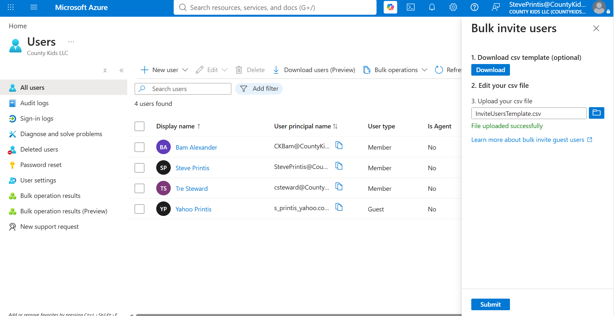

# **Exploring Dynamic Goups**

1.	Under **Groups**, select **All Groups**, and then select **New group**.

2.	On the New Group page, under **Group type**, select **Security**.

3.	In the **Group name **box, enter **All company users dynamic group**.

4.	Select the **Membership type** menu and then select **Dynamic User**.

5.	Under **Dynamic user members**, select **Add dynamic query**.

6.	On the right above the **Rule syntax** box, select **Edit**.

7.	In the Edit rule syntax pane, enter the following expression in the **Rule syntax** box: user.objectId -ne null

8.	Select **OK**. The rule appears in the Rule syntax box.

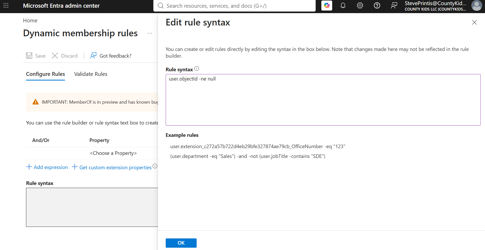

# **Configure Microsoft Entra Multifactor Authentication Registration Policy**

1.	On the Identity protection blade, in the left navigation, select Dashboard and then **Multifactor authentication registration policy**.

2.	Under **Assignments**, select **All users**.

3.	Under Controls, **Require Microsoft Entra ID multifactor authentication registration** is selected and cannot be changed.

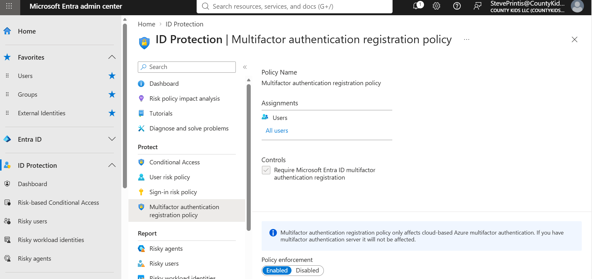

# **Configure Multifactor Authentication Option**

1.	Search for **Microsoft Entra ID** and navigate to the Microsoft Entra ID dashboard.

2.	Select **Security** in the left-hand menu.

3.	Under the **Manage** menu, select **Multifactor authentication**. Here, you find options for multifactor authentication.

4.	Under **Configure**, select **Additional cloud-based multifactor authentication settings**. On the resulting page, you can see all the MFA options for Azure under **Service Settings**.

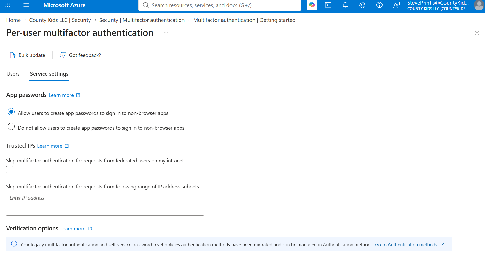

# **Setting Conditional Access Rules For MFA**

1.	Switch back to the Azure portal and select **Microsoft Entra ID**>**Manage**>**Security**>**Protect**>**Conditional Access**.

2.	Select **Create new policy** from the top menu.

3.	Name policy **All Guests**

4.	Under **Assignments** look for **Users** and select **0 users and groups selected**

5.	Under **Include**, choose **Select users and groups**. Select from list of users and groups and then choose “**Select**.” 

.png)

6.	Under **Assignments** look for **Target resources**, select **No target resources selected**. Under **Include**, choose **Select resources**. Under **Select Specific Resources**, choose **None**. Select apps from the options on the right and then choose **Select**.

.png)

7.	Under **Conditions**, select **0 conditions selected**. Under **Locations**, select **Not configured**. Under Configure, select Yes, then select **Any location**

.png)

8.	Under **Grant**, select **0 controls selected**. Make sure that **Grant access** is selected. Select **Require multifactor authentication** and choose **Select**. This option enforces MFA.

9.	Set Enable policy to On, then select **Create**

.png)

# **Configure Authentication Session Controls**

1.	 Navigate to **Microsoft Entra ID**>**Manage**>**Security**>**Protect**>**Conditional Access**.

2.	Select **Create new policy** from the top menu.

3.	In the Name box, enter **Sign in frequency**.

4.	Under **Assignments**, select **Users and groups**.

5.	On the Include tab, select the **users and groups** check box.

6.	In the Select pane, select Admin account.

7.	Select Target Resources.

8.	On the Include tab, select **Select resources** and then **Select Specific Resources**

9.	In the Select pane, select **Office 365**.

10.	Select the Session pane, select Sign-in frequency.

11.	In the value box, enter **30**.

12.	Select the units menu, select **Days**.

13.	Under Enable policy, select **Report-only**, and then select Create.

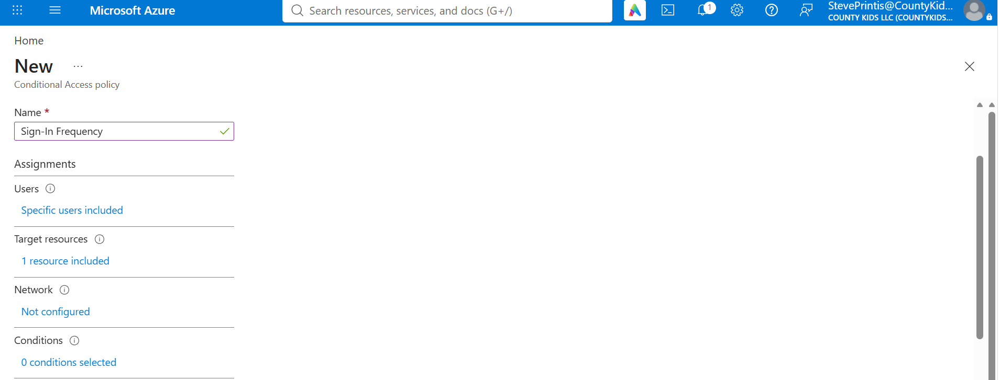

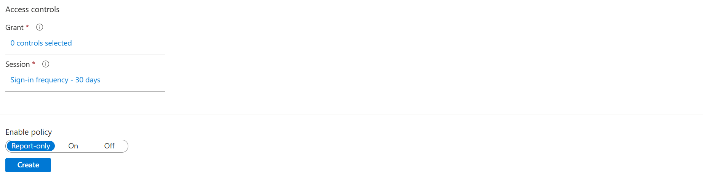

# **Enable FIDO2 Security Key Method**
1.	Sign into the Microsoft Entra admin center.

2.	Browse to **Security**>**Manage**>**Authentication methods**

3.	Select the **Passkey (FIDO2)** built in method choose the following options:
  o	**Enable** - Yes or No
  o	**Target** - All users or Select users

4.	**Save** the configuration.

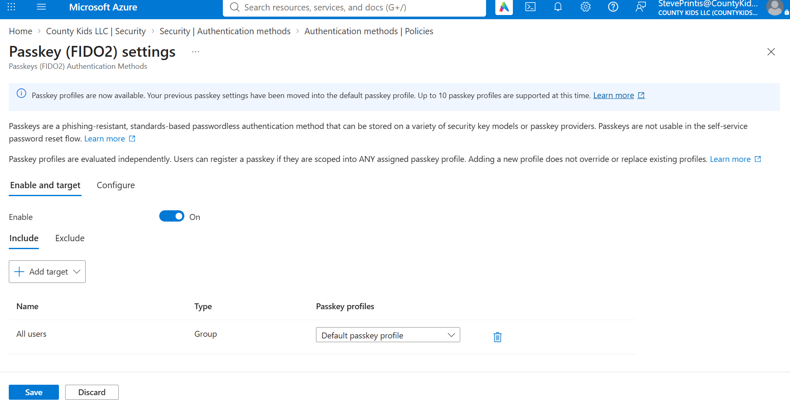

# **Manage Microsoft Entra Smart Lockout Values**

1.	Navigate to Microsoft Entra ID and then select **Manage**>**Security**>**Manage**>**Authentication Methods**.

3.	On Authentications methods menu, select **Password protection**.

4.	In the Password protection settings, in the **Lockout duration in seconds** box, set the value to 180.

5.	Next to **Mode**, select **Enforced** and save changes.

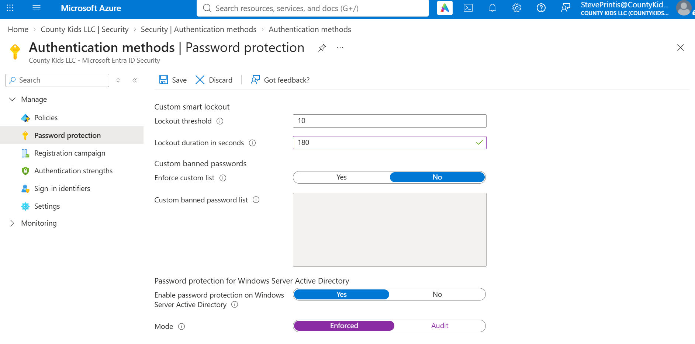

# **Enable Self-Service Password Reset**

1.	Navigate to Microsoft Entra ID, then select **Manage**>**Password Reset** from the menu on the left side.

2.	Select the Properties tab, under the option **Self-service password reset**, pick **Select Group**

3.	Browse for and select **SSPR-Test-Group**, then choose **Select**.

4.	To enable SSPR for the chosen group, select Save.

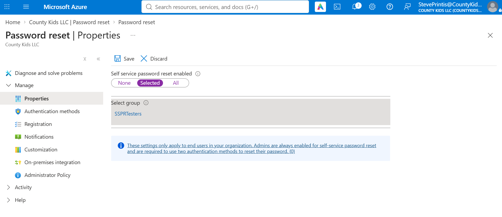

# **Enable User Risk Policy**

1.	Sign in to the Microsoft Entra admin center using a Global administrator account.

2.	On the left hand side menu, select **ID Protection**.

3.	On the ID Protection blade, select **Dashboard** and then **User Risk Policy**.

4.	Under **Assignments**, select **All users**.

5.	Under **User risk**, select **Low and above**.

6.	In the User risk pane, select **High** and then select **Done**.

7.	Under **Controls**, then **Access**, and then select **Block access**.

8.	In the Access pane, select the **Require password change** check box and then select **Done**. 

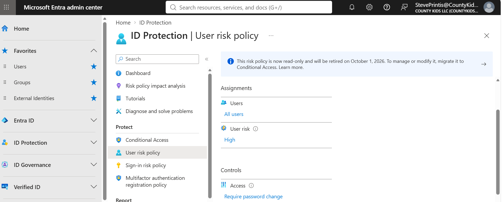

# **Enable Sign-In Risk Policy**

1.	On the Identity protection blade, in the left navigation, select Dashboard and then **Sign-in risk policy**.

2.	As with the User risk policy, the Sign-in risk policy can be assigned to users and groups and allows you to exclude users from the policy.

3.	Under **Sign-in risk**, select **Medium and above**.

4.	In the Sign-in risk pane, select **High** and then select **Done**.

5.	Under **Controls**, then **Access**, and then select **Block access**.

6.	Select the **Require multifactor authentication** check box and then select **Done**.

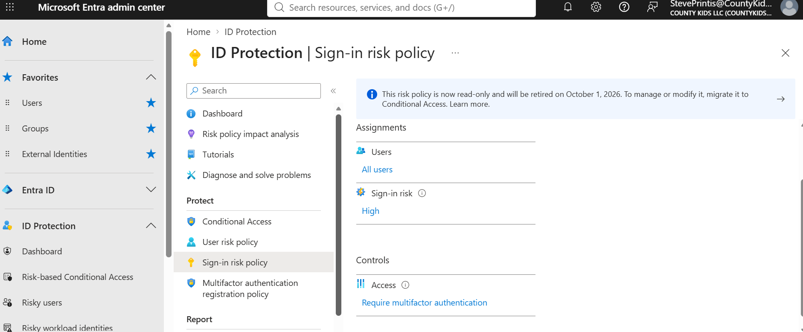

# **Adding An App To Microsoft Entra Tenant**

1.	Open the Entra Admin center menu and then select **Entra ID**, and then select **Enterprise applications**.

2.	In the **Enterprise applications** pane, select **+ New application**.

3.	In the **Browse Microsoft Entra Gallery** page, in the **Search application** box, enter **GitHub**.

4.	In the results, select **GitHub Enterprise Cloud – Enterprise Account**.

5.	In the **GitHub Enterprise Cloud – Enterprise Account**, review the settings and then select **Create**.

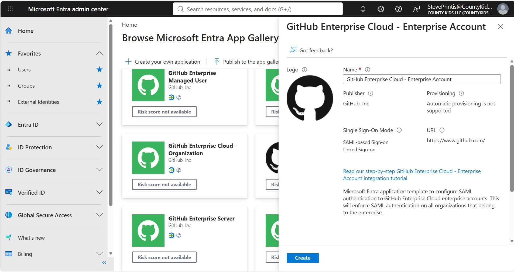

# **Assign Users To An App**

1.	On the **GitHub Enterprise Cloud – Enterprise Account** screen, on the **Overview** page, under **Getting Started**, select **Assign users and groups**. 

2.	On the **Users and groups** page, on the menu, select **+Add user/group**.

3.	On the **Add Assignment** dialog, select **Users and groups**.

4.	In the **Users and groups** pane, select your administrator account and then **Select**.

5.	Select **Assign**.

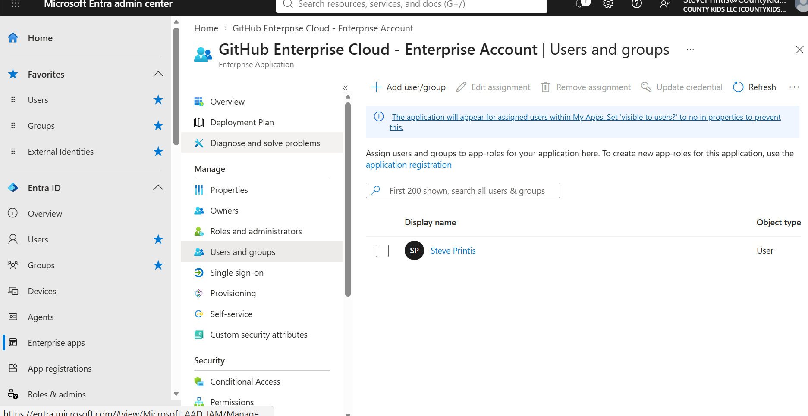

# **Creating Custom Role To Manage App Registration**

1.	On the Entra ID menu select **Roles and administrators**.

2. On the Roles and administrators screen, on the menu, select **New custom role**.

3.	In the New custom role dialog, on the **Basics** tab, in the name box, enter **My custom app role**.

4.	Review the remaining options and then select **Next**.

5.	On the **Permissions** tab, review the available permissions.

6.	In the **Search by permission name or description** box, enter credentials.

7.	In the results, select the **Read password single sign on credentials on service principals**, and **Manage application provisioning secrets and credentials** permissions and then select **Next**.

8.	Review the changes and then select **Create**.

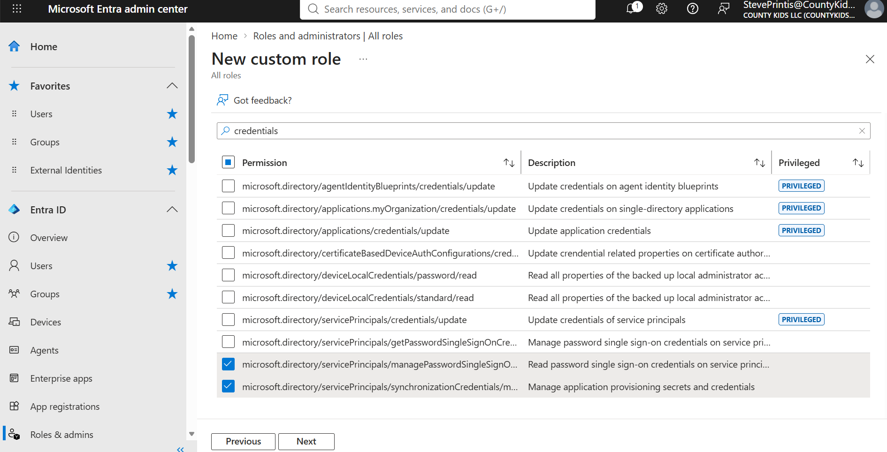

# **Add App Roles To An Application**

1.	On the **GitHub Enterprise Cloud – Enterprise Account** screen, on the Overview page, under **Manage**, select **App Roles** and then **Create app role**.

2.	In the Create app role pane, in the **Display name** box, enter **Survey Writer**.

3.	Under **Allow member types**, select **User/Groups**.

4.	In the **Value** box, enter **Survey.Create**.

5.	In the **Description** box, enter **Writers can create surveys**.

6.	Notice that the description is a mandatory field.

7.	Verify the **Do you want to enable this app role** is selected and then select **Apply**.

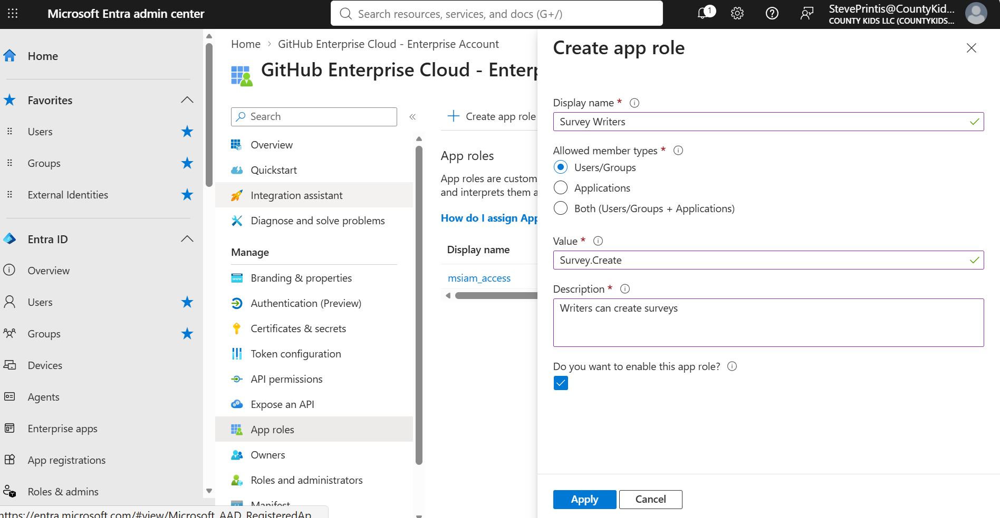

# **Create Access Reviews For Groups & Apps**

1.	Sign in to the Microsoft Entra admin center 

2.	Browse to **ID Governance**>**Access reviews**.

3.	Select **New access review** to create a new access review.

4.	On the Access reviews template screen, select **Review access to a resource type**.

5.	In the **Select what to review** box, select **Teams + Groups**.

6.	Select the **select Teams + Groups** option and select groups.

7.	Select **All Users** for the **Scope**.

8.	Select **Next: Reviews**.

9.	In the **Select reviewers** section, select **Group Owners** for First and Second Stage of Review

10.	Select Settings, In the **Upon completion settings**, check the box for “Auto apply results to resource”

11.	Select **Next: Review + Create**.

12.	Review information and then select **Create**.

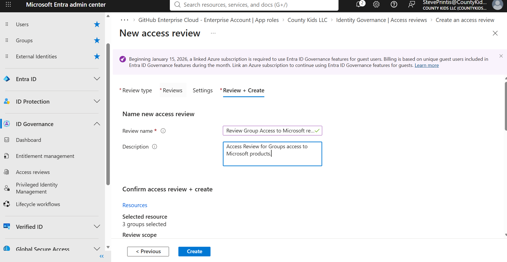

# **Create A Catalog**

1.	From Microsoft Entra ID home screen, select **ID Governance**.

2.	In the left menu, select **Catalogs**.

3.	On the top menu, select **+New Catalog**.

4.	In the New catalog pane, in the **Name** box, enter **Marketing**.

5.	In the **Description** box, enter **For marketing department users**. Users will see
this information in an access package's details.

6.	Select **Yes** for enabled for users to request and enabled for external users to request.

7.	Select **Create**.

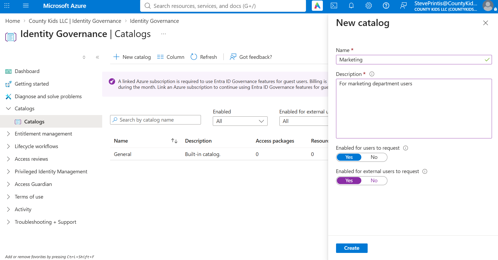

# **Add Resources To Catalog**

1.	On the Identity Governance screen, select **Catalogs**.

2.	In the **Catalogs** list, select **Marketing**.

3.	In the left navigation, under **Manage**, select **Resources**.

4.	On the menu, select **+Add resources**.

5.	In the Add resources to catalog screen, review the available options.

6.	Select the **Groups and Teams** category then select the **Marketing** Security Group from that category.

7.	Select **Add**.

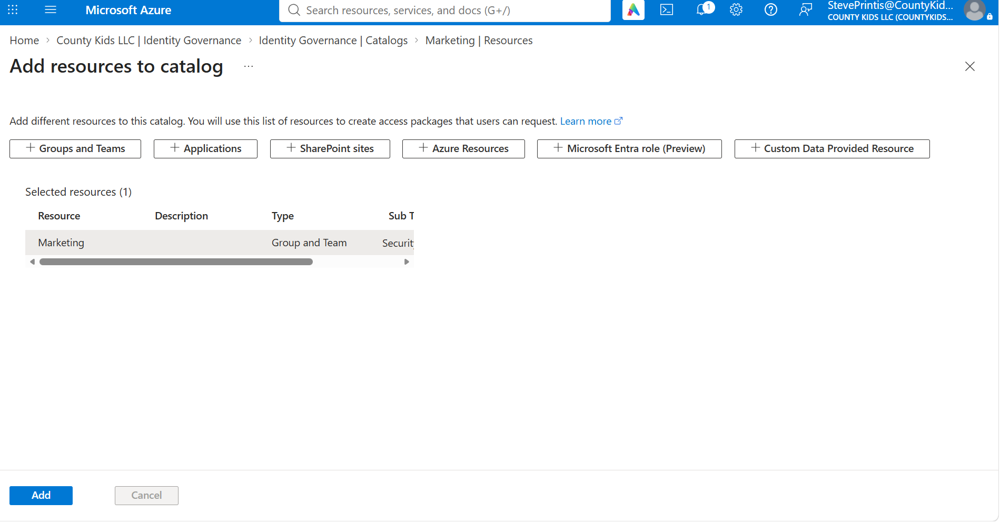

# **Add Catalog Owners**

1.	In the Marketing catalog, in the left navigation menu, select **Roles and administrators**.

2.	On the top menu, review the available roles and then select **+Add Catalog owner**.

3.	In the Select members pane, select user **Tre Steward** and then select **Select**.

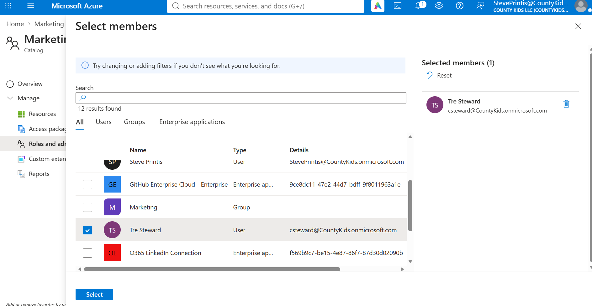

